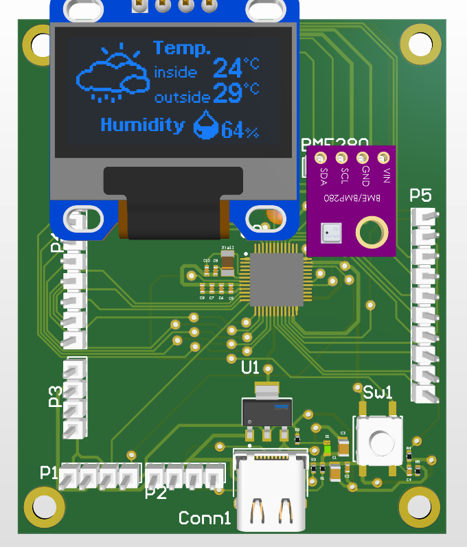
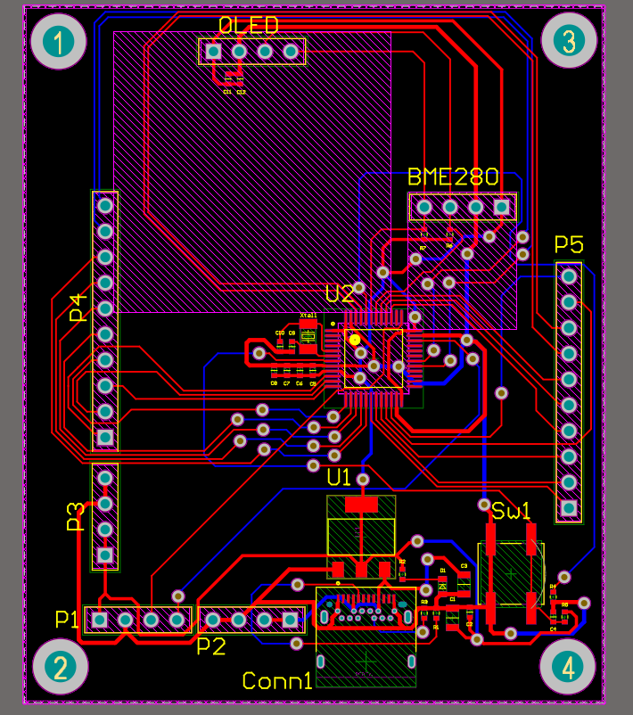
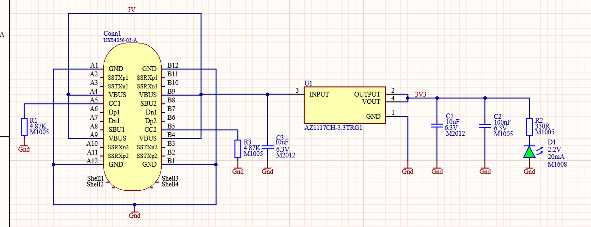
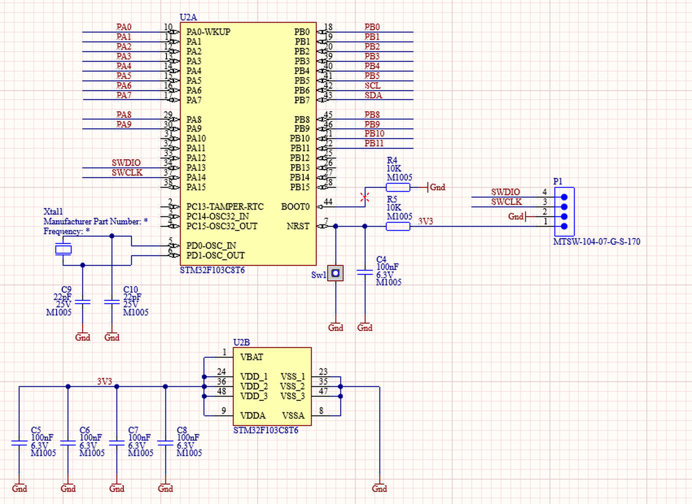

# STM32-Based Smart Sensor & Development Board


A compact, USB Type-C powered **STM32F103C8T6 development board with an on-board environmental sensor and OLED display**. Every GPIO of interest is broken out to headers, so the board works both as a standalone smart sensor node and as a general-purpose Cortex-M3 development platform.

<p align="center">
  
</p>

## Features

- **MCU:** STM32F103C8T6 (ARM Cortex-M3, 64 KB Flash, 20 KB RAM, LQFP-48)
- **Sensing:** BME280 breakout module (temperature / humidity / pressure) over I²C
- **Display:** 0.96" 128×64 OLED module over I²C
- **Power:** USB Type-C input (5 V) with CC1/CC2 pull-down resistors, AZ1117CH-3.3 LDO (SOT-223) generating the 3.3 V rail, power LED
- **Debug / programming:** 4-pin SWD header (3V3, GND, SWDIO, SWCLK)
- **Reset & boot:** tactile reset button, BOOT0 pulled low, NRST pulled up
- **Expansion:** PA0–PA9 and PB0–PB5, PB8–PB11 broken out; 5 V and 3.3 V power headers
- **Board:** 2-layer PCB, 57.2 × 68.7 mm, 0402 passives, mounting holes in all four corners

## Gallery

| 3D view | PCB layout (top / bottom) |
|:---:|:---:|
|  |  |

## Schematics

| Sheet | Content |
|---|---|
| [`01_Power`](docs/images/schematic-power.png) | USB Type-C receptacle (GCT USB4056), CC1/CC2 pull-downs, AZ1117CH-3.3 LDO, input/output capacitors, power LED |
| [`02_MCU`](docs/images/schematic-mcu.png) | STM32F103C8T6, crystal with load capacitors, per-pin decoupling, reset/BOOT0 network, SWD header |
| [`03_Sensor_Display`](docs/images/schematic-sensor-display.png) | BME280 and OLED I²C connectors with pull-ups and local decoupling |
| [`04_GPIO_Header`](docs/images/schematic-gpio-header.png) | GPIO breakout headers and 5 V / 3.3 V power headers |

### Power stage



<details>
<summary>Show MCU sheet</summary>



</details>

## Pin usage

| Header | Pins |
|---|---|
| **P1** (SWD) | 1: 3V3 · 2: GND · 3: SWCLK · 4: SWDIO |
| **P2** (5 V) | 1: 5V · 2: 5V · 3: NC · 4: GND |
| **P3** (3.3 V) | 1: 3V3 · 2: 3V3 · 3: NC · 4: GND |
| **P4** (10-pin) | PA0 – PA9 |
| **P5** (10-pin) | PB0, PB1, PB2, PB3, PB4, PB5, PB8, PB9, PB10, PB11 |
| **I²C bus** | PB6 = SCL, PB7 = SDA (shared by BME280 and OLED) |

> The BME280 and OLED connectors are 4-pin headers in the order **3V3 · GND · SCL · SDA**. Check the pin order of your own modules before plugging them in.

## Repository structure

```
.
├── hardware/altium/     # Altium Designer project (.PrjPcb, schematics, .PcbDoc)
├── docs/images/         # Schematic and PCB images
├── manufacturing/       # Bill of materials
├── LICENSE
└── README.md
```

## Getting started

1. Open `hardware/altium/Akilli_Sensor_Dugumu.PrjPcb` in Altium Designer.
2. Review the four schematic sheets (`01_Power` to `04_GPIO_Header`) and `Akilli_Sensor_Dugumu.PcbDoc`.
3. To program the board, connect an ST-Link to the **P1** SWD header (3V3, GND, SWCLK, SWDIO) or use the USB-powered board together with an external debugger.

## Bill of materials

The BOM is in [`manufacturing/bom.csv`](manufacturing/bom.csv): 32 components, 14 unique line items.

| Part | Description |
|---|---|
| U2 | STM32F103C8T6, LQFP-48 |
| U1 | AZ1117CH-3.3 linear regulator (3.3 V), SOT-223 |
| Conn1 | GCT USB4056 USB Type-C receptacle |
| Xtal1 | NDK NX3215SA crystal |
| Sw1 | Panasonic EVQ-Q2 tactile switch |
| Passives | 0402 resistors and capacitors, 0805 bulk capacitors (10 µF) |

## Design notes

- Decoupling capacitors are placed at every VDD pin of the MCU, plus local 100 nF capacitors on the sensor and display connectors.
- I²C lines have dedicated pull-up resistors, shared by both peripherals.
- Routing was done on two layers with attention to signal integrity and power distribution.
- The design passes Altium's Design Rule Check with zero errors.

## Author

**Bekir Kılıç** — Electrical & Electronics Engineering student, focused on embedded systems and hardware design.

## License

Released under the [MIT License](LICENSE).
